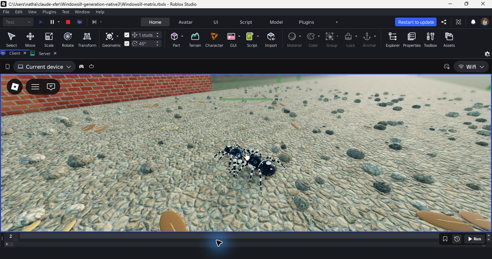

# Native mating, eggs and next-generation audit

2026-10-24. Test commit `3f6ed486cf0a6fa2b20c47c1b0c857ef7ff98200`, branch
`codex/verified-integration`. Ordinary game sources remain identical to
`fa7367fb`; export evidence remains `5e9ac432e9933ed9` with 273 sources. The
only committed test change adds a seven-meal assertion after the real Carry
choice, before any save return. No new game-code change is justified by the
transition investigation below. Private published version 14 still contains
the earlier `032b5985ac17eeb2` cohort. Production is unchanged.

## Sex-specific scope and pending design

These results cover the **default female spider in three difficulty modes** (Normal, Easy and Free), not male and female playthroughs. Nathan confirmed that the male does not lay eggs or care for the young. Nathan and Claude are designing separate male and female playthroughs; the male route remains open and is not implemented by this audit.

The current shared reproductive chain has a known design gap: `Mating.sexOf` selects a sex from the appearance, but `Mating.woke` creates the sac after the mated stage without checking sex. Do not treat the default-female native results as evidence for a biologically correct male route. Resolve male continuation separately with the agreed design, rather than giving him the female brood-care tasks.

## Coverage that was missing

`tests/client_mating.luau` covers client presentation and the reproductive
chain, but builds several conditions directly and disables Normal's seeded
acceptance decision during the later chain. `tests/mating.luau` covers the
pure rules. Those are useful isolated checks; neither proves a fresh native
spider can grow, attract a live mate, pass its real decision, lay eggs and
continue the family through the ordinary client in all three modes.

`playback.luau` extends the separately qualified feeding/moult driver with that
route. It is unbound, Studio-only, SelfTest=false, and uses a yielding memory
backend. It is not a publication candidate and never uses DataStoreService.
The normal 273 game sources are combined with three guarded diagnostic sources.

The following are fixture setup rather than ordinary player accomplishments:
successful full-housefly captures; safe positioning in the Crack; the player's
approach to the mate and facing it. No mate position, state, meter, seeded
decision, energy, growth, brood or outcome is assigned. Normal's acceptance
rules remain enabled; retries after a refusal happen on later mornings.
The live drive supplies sight and motion, and the usual interference and
scene timers remain active. The clock runs faster for waiting and moults;
fixed action ticks, feeding, courtship and scene durations are unchanged.

The full route requires, for Normal, Easy and Free play separately:

- Fresh-spider feeding through the real struggle/tap/eating path: 7 + 10 + 5
  growth meals for Normal and 7 + 10 + 3 each for Easy and Free. All nine
  moults/hardenings, unlocks, drawn instars and local rests remain checked.
- A well-fed adult rest, a real visitor, a live courtship result and mating.
  The first partial Normal route saw a natural refusal, then accepted courtship
  on a later visit; it never switched off the acceptance rule to proceed.
- The next sleep makes an egg sac, the two guard days occur in order, and
  the real retained guarded family is reopened before hatching. The hatch
  day and brood are compared with the seeded result, not rerolled or forced.
- The hatching scene, its nonempty drawn plan, and the actual family card.
  Normal and Easy choose Carry; Free chooses Follow and completes its ride.
- The new family has the right generation, hatch-day grace, meal baseline,
  fresh energy, first-stage rig and cleared old sac. Run and lock-on are locked.
  Before any save return, the ordinary fixed tick must admit the seven-meal
  first-moult rule within two seconds. Three full meals then leave it unready
  to moult. A new retained rest and local return preserve that .9 growth credit.
- Server finish has no active, started or queued operation scopes and destroys
  all created scope options. Exact 276-source guards must pass before and after.
  This is local operation cleanup, not an online lease-release assertion.

## Investigation history: the apparent three-meal target

The initial diagnostic build (`prepare1.txt`) failed strict typing because
assertions narrowed fields that later asynchronous ticks change. Small read
helpers fixed the diagnostic typing; no product source changed.

The second model compiled and strict-checked all 276 sources. Native run
`1792851284491` completed Normal growth, a refused and then accepted live court,
the sac, guarding, guarded local return, eleven seeded spiderlings, Carry and
the next-generation local return. Easy was underway when the run was deliberately
stopped to investigate a suspicious observation. Both source guards passed;
Studio PID 23056 exited and the model hash stayed unchanged. The scripted
server finish was not reached. This is not a completed three-mode pass.

The observer emitted a new generation's `mealGoal=3` immediately after Carry,
then `7` in the later local-return observation. The first interpretation blamed
the generation transition and credited the return with repairing it. That
interpretation was **disproved**: the existing ordinary fixed tick in
`SpiderClient.client.luau` calls `growth:useGameRules(needs.gentle)` before any
feeding or LifeLoop tick when the new Growth has no game-rules flag. Carry runs
in a UI callback between ticks; the observer sampled that intermediate model.
The HUD at that first sample still had its prior empty adult counter, not a
visible three-meal prompt. The return was correlated with, not responsible for,
the later correct rule.

The new client assertion after Carry and before any return passed on the
unchanged game code: `CLIENT_MATING passed=29 failed=0`. The output is retained
as `red.txt`, its original hypothesis-test filename; it is a passing check,
not red/green proof of a product fix. `defect-native2/` likewise retains its
original investigation name and immutable partial evidence; `analysis.json`
records the corrected diagnosis. Do not quote that folder name as a confirmed
bug. No extra call or rule assignment was added to the product.

The third fixture now observes the ordinary rule-admission tick before any
save return, then tests three actual meals in each new generation. This closes
the observer gap while retaining all real game rules and checkpoint validation.
`collect.py` refuses a partial run, game warning, missing guard, missing family,
missing next-generation meals or missing operation cleanup. `qualify.py` binds
the actual source, new test assertion, immutable model and closed log, current
exports, and the exact new CI run `40102350037`.

## Verified result

Corrected native run **1792852025863 passed**: three complete reproductive
routes (Normal, Easy, Free), nine moults/hardenings, three guarded-family returns
and three newborn returns. It consumed **90 full flies** through ordinary
input-state taps: 62 growth meals, 19 adult refueling meals and nine newborn
meals. Every newborn remained unready at three of seven meals, and its retained
rest preserved .9 growth credit. Normal's first court was refused and the next
accepted; the rule stayed enabled. All three broods contained eleven, with
Normal hatching on day 9 and the gentle modes on day 8, as the seed predicted.

Free's actual Follow choice spanned **12.075 seconds** from the family card to
an attached newborn with the correct seven-meal rule, matching the authored
twelve-second ride. The fixture checks the choice, arrival and subsequent meals;
it does not inspect every intermediate flight pose or the whole landing area.

Both exact 276-source guards pass. Zero CreatorErrors and zero Windowsill game
warnings; six retained other warnings (four Studio UDim style casts, two asset
type mismatches). Finish reports zero active/started/queued scopes and all 12
options destroyed. Its owner record remains present, so no real lease/rejoin
claim follows from that memory diagnostic. Studio PID 21692 exited before
collection, and the model hash remains
`8902f51c192376349af5f0b37bfdfd535ac28757bee40c4411e3acf71d24683e`.

The exact new [CI run 40102350037](https://github.com/socranates/jumping-spider-sim/actions/runs/40102350037)
**succeeded** on `3f6ed486`: all 80 default suites, compile, strict types,
normal/self-test exports and runner cleanup regressions. `github-ci.json`
retains actual job/step results. `native-final/`, `qualification.json` and the
successful `qualify.py` bind the current source and test, closed native log,
immutable model, existing exports and CI. No new game-code fix or publication.

## Warning triage and remaining boundaries

The captured Studio view shows the live Easy pairing in the garden. It is a
single observed frame, not a complete clipping, comfort or animation review.

`asset-warning.json` records an official metadata lookup for asset 203785492:
Roblox names it "Pop Close Sound", asset type 3. None of the 273 game sources
contains that ID. Its mismatch warning also appears in edit-mode startup before
the fixture executes. The requesting instance and requested type remain
unidentified, so metadata/source absence alone does not prove who requested it.
The warning remains in receipts and is not fixed by replacing unrelated game
assets. No asset bytes were downloaded. Studio style-cast warnings are retained
too; a run with those warnings must not be called warning-free.

These are local Studio/memory routes with scripted captures and player approach.
They do not prove natural hunting/traversal, physical controller/touch comfort,
online persistence/rejoin, phone performance, overall FPS gains, or a complete
world collision/content audit. The broader foundation goal remains active.
