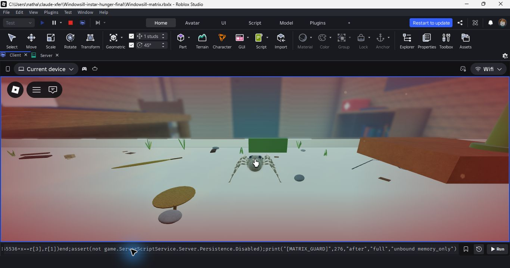

# Instar ladder and encroaching hunger — handback

Candidate evidence **7c0bede90b301ac2**, 273 ordinary game sources. Branch `codex/verified-integration`, checkout `C:/Users/natha/windowsill-verified-integration`. **Unpublished.** Godot, golden fixtures, the OneDrive original and synced project references are unchanged.

## What changed

- Five or six playable moults from instar 2 to a saved, seeded maturity at instar 7 or 8. New generations keep the ladder with a new child seed; loading a saved life keeps its existing draw.
- Normal goals 4/6/8/11/15/20; early maturers omit the middle 11-meal goal. Easy/Free have lower goals. See [the complete plan and implementation choices](PLAN.md).
- Nathan's latest override: **Run after moult 2; lock-on after moult 5**. The earned-control explanation appears at completion; controls/touch availability do not reveal later abilities early.
- Old stages migrate to equivalent instars, retaining consumed credit, readiness, running moult progress, softness, old skins and historical abilities. A legacy subadult keeps lock-on. The new validator accepts the five/six-stage ladder and rejects malformed metadata atomically.
- Adult eligibility, notebook adulthood and Easy unlocking use actual maturity, and the drawn size advances at every moult without repeated-frame rescaling work. Approved costume endpoints and motor geometry are retained.
- Hunger defaults to soft red edges that gradually move inward as food runs out and ease back after eating. The spider and aim remain in a clear centre. No pulse, flash or new camera effect. Comfort settings retain the small wordless bar. Menus, death and inspection suppress the edges.

## Verification

Game source: `455dd28ffcc2c96e21297b8dacb2c1389c064a3b`. Final source/test CI head: `7841306564588933888f87e7040702968814db97` (only an expected Normal-counter value changed after the game commit). All later ordinary game source bytes are identical.

- Focused: instars **10,806/0**, hunger **230/0**, frozen growth **574/0**, checkpoints **607/0**. The final corrected real-client slot/counter suite is **161/0**.
- Compilation **273/273**; strict source checks clean.
- Full 82-suite CI **40110260962: SUCCESS**. The previous exact-head run failed the counter assertion that accidentally expected Easy's goal in Normal. Its bounded failure output is retained. [Local development-run limits](local-attempt1-note.md) explain why the interrupted laptop sweep is not used as full qualification.
- Unbound Studio/memory run **1792858219060**: **17 moults, three adults, three interrupted-moult local returns**, exact new unlocks/goals and drawn sizes, pressure at three reserve levels and bar fallback. Both 276-source guards pass; Studio exited; the model and closed log are hashed. Operation scopes/active jobs return to zero; all 11 options are destroyed. **Zero CreatorErrors**, six retained existing style/asset warnings.

The native run scripts seeds, food/reserve credit, placement and the moult clock. It exercises ordinary growth/rest/save/return/rendering but does **not** establish hunting difficulty, natural survival, FPS, online persistence or physical-device comfort. `native-attempt1/` retains a failed diagnostic that credited growth without refuelling the reserve; the corrected fixture passes. The separately built `Windowsill-instar-hunger-native2` was not run; the qualified final fixture is `Windowsill-instar-hunger-final`.

## Remaining work and handoff

Stage-sized prey and stage-relative currency, retreat/moult hazards, actual carapace-size calibration and measured skilled/careless survival are **not implemented by this candidate**. [Feeding research](FEEDING-RESEARCH.md) supplies a primary-source basis for fruit flies early and houseflies later, without treating an experimental feeding schedule as a moult requirement. Old evidence scripts pinned to earlier growth numbers remain historical; use this cohort's playback for this ladder.

The broad goal remains active: Carry/Follow rejoin policy, natural predator attacks, whole-map collisions, physical devices, remaining performance scenes, corrupt-slot recovery and other audit limits are still open. Male continuation still needs its own approved path; males never enter female sac/guarding logic.

For Claude: use the branch above, start with `PLAN.md`, `qualification.json` and `native-final/result.json`, then continue the next bounded biological/audit increment. Do not overwrite the OneDrive source or relabel old evidence as proof of this candidate. No private or production publication was performed for this cohort.
