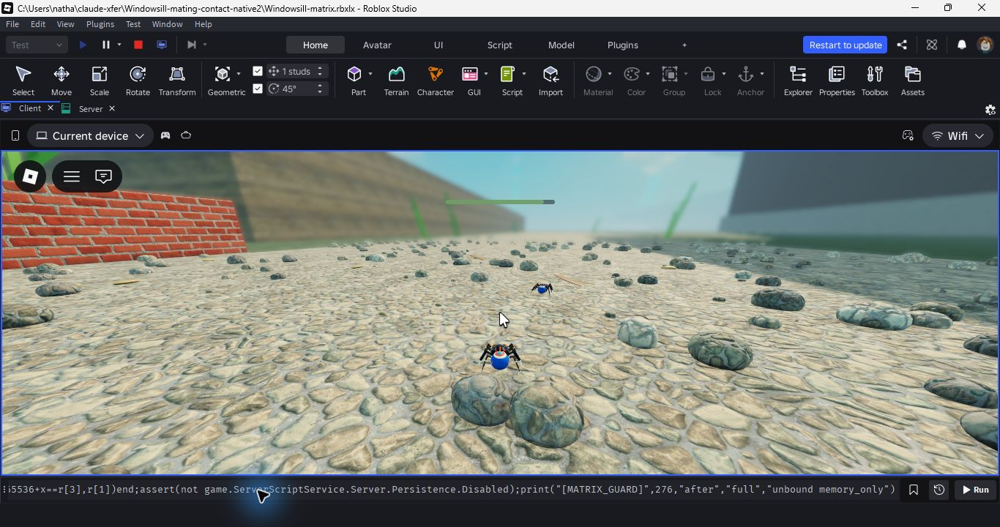

# Mating corrections after Claude review — 2026-10-24

Game-source commits `79dd87f2` and `fdf88814`, followed by test correction `75ff806d` on `codex/verified-integration`.
Ordinary export evidence `88c68c98a0324e8a`, 273 game sources. Unpublished.

## Scope and current design

Nathan resumed the audit after Claude's read-only review, then said the moult mechanic is being redesigned for scientific accuracy. The updated review's section 5c supersedes the proposed three-moult 7/15/20 retuning. Nathan subsequently answered: **"Still discussing; fix mating first."** No instar ladder, meal-goal change, unlock-timing change, survival-odds tuning or per-life seed was implemented here. Current growth tuning stays 7/10/5 in Normal and 7/10/3 in Easy/Free. The frozen Godot replay is unchanged.

`../claude-reviews/quick-review-2026-10-24.md` preserves the updated external review as reference, including proposals and unsourced biological estimates. Those are not all accepted requirements or verified scientific facts. The missing male/female playthrough design file cited by that review was not found in the local handoff folders; do not invent its contents.

## Player-visible corrections

- Accepted courtship binds `player_sex` to that reproductive cycle. Only a female cycle can make an egg sac. Male sac/guarding/hatched records are invalid. Older reproductive records without sex retain their female interpretation.
- A reproductive rest restores the appropriate sex even if a conflicting cosmetic is selected. Selecting a different spider is blocked during that cycle; inspection remains available when otherwise safe. The CLI client exercises a real female-sac local return after selecting a male cosmetic, and a real male sleep with no sac or guard prompt. Male continuation remains an open design: he stays mated and receives no female brood-care tasks; this does not add repeat male matings or a male ending.
- Ordinary partner walking uses swept body clearance, allowing outward movement and tangent sliding. The mate steers around the player using supported candidates outside its route keep-out. The player is never pushed or teleported to resolve overlap. Intentional paired poses keep their existing behavior. Rival movement and jump/silk flight are unchanged.
- A departing mate reclaims its exit goal after stuck handling clears it. In the Preserve, the exact supported exit is preferred over a sparse scenery waypoint.
- Earned moult readiness is sticky: eating again cannot cancel the readiness of a valid older save whose goal was smaller. No threshold or save-format change accompanies this correction.

Clearance applies only to attached walking on aligned support planes (within 25 degrees, height offset under .25 studs). Floor-to-wall seams and airborne collisions are not resolved by this change and remain audit limits. Bodies, not full leg spans, define clearance; there is a .6-stud minimum. This is not a general collision solver for every animal.

## Regression and native evidence

Pure mating suite: **773 passed, 0 failed** on final source (`mating-final.txt`), including both mate sexes, normal/skip departures, inward/outward/sideways walking, escape from overlap, different support planes, restored exit goals, the Preserve exit and sex binding. The new sex test first failed 11 checks on the old code, then passed after the gate. Growth: 574/0, real client mating: 29/0, motor box-world scenarios: 21/0, recovery templates: 56/0. The latter focused runs were on `79dd87f2`; `fdf88814` only adds the supported-exit correction and its two pure checks. The first full CI (`40105959314`, `79dd87f2`) caught an old nature test that explicitly expected a male to lay eggs. Its bounded failure output is retained in `ci-attempt1-failure.txt`. `75ff806d` corrects that expectation and adds the corresponding accepted female court/sac check; `NATURE passed=28892 failed=0` locally. Ordinary game sources are byte-identical between `fdf88814` and `75ff806d`; the native run therefore still binds the exact current game code. Full CI on the corrected test commit succeeded; see the final qualification below.

`focused-attempt1.txt` retains a runner invocation typo (`server_recovery_templates.luau` does not exist). Its four completed suites passed. The correctly named recovery suite was then run separately (`recovery.txt`); `focused.txt` extracts the successful summaries, and does not pretend the typo invocation exited successfully.

All 273 ordinary sources compile and strict-check. The final native fixture compiles and strict-checks all 276 sources, including the three isolated diagnostic sources. The extra luau-lsp watcher-registration warning is a tool capability notice; no type diagnostics were emitted. Ordinary and self-test exports were rebuilt with the same evidence ID.

The initial native fixture (`native-attempt1/`, run `1792855052955`, commit `79dd87f2`) **failed** waiting for the mate to leave; it did not complete cleanup or all four routes. Pure navigation inspection found that the selected Preserve waypoint was 26.569 studs from the authored exit; both the arrival and actual exit belong to floor face 4, and the exit is outside keep-out. This motivated `fdf88814`, rather than relaxing the native deadline or accepting a timeout disappearance. The failed fixture, source manifest, output, two guards, closed log digest and unchanged model digest are retained.

Final fixture: `native-final/`, run `1792855445329`, commit `fdf88814bac93f722ab3451e75d9e28fb4aea4bd`.

| Played sex / mate | Scene | Body radius | Smallest gap | Samples | Exit distance |
| --- | --- | ---: | ---: | ---: | ---: |
| Female / male | Ordinary | 1.162696 | 1.162758 | 545 | 1.495674 |
| Female / male | Skipped | 1.162696 | 1.162757 | 520 | 1.498797 |
| Male / female | Ordinary | .6 | .600133 | 438 | 1.489285 |
| Male / female | Skipped | .6 | .600134 | 426 | 1.487392 |

All four routes passed, **1,929 departure samples**, zero support losses and zero CreatorErrors. Every visitor left with reason `mated` inside the 1.5-stud exit radius, rather than timing out. Both male fixtures also refuse egg-sac creation. Final cleanup has no active operation scopes and destroys all created options; this is memory-backend operation cleanup, not online lease/rejoin proof. Six retained Studio style/asset warnings remain; do not call the session warning-free.

Studio PID 26696 exited before collection. Both exact 276-source guards passed. The model remained byte-identical, SHA256 `a6be877646b10b25c2b35ea4cac329205e075aac7423cfb64c860e1456b4e9a3`; closed-log digest `0058f8cc4950f16e0006a15b8181f98e6569efd92876a6b9a966512474610f94`. `collect.py` refuses missing guards, an open process, changed model, missing routes or failing contact/cleanup assertions.

The screenshot is one observed rendered separation frame; it is not the exact closest approach. The native fixture assigns adult growth/energy and synthetic paired records, scripts player placement/camera, then holds real Forward for three seconds. Actual motors, scene/skip timers, body clearance, route navigation, support and departure conditions run normally. This proves a bounded full-detail garden contact case, not natural attraction/acceptance, every limb's overlap, wall seams, every map location, physical devices, online storage or performance. The prior 90-meal female-life receipt remains evidence of its earlier source cohort and is not relabeled as a rerun of this code.

## Final qualification

[CI 40107325851](https://github.com/socranates/jumping-spider-sim/actions/runs/40107325851) **succeeded** on exact test commit `75ff806d7775fb76fa2f2fc0eee6a23bfdfb5626`: all 80 default suites, 273-source compile, strict types, ordinary/self-test exports and runner failure/cleanup checks. `qualify.py` passed and binds current committed sources/tests, exact native source bytes (unchanged since `fdf88814`), the immutable native model, closed log, final exports and live completed CI. `github-ci.json` retains actual run/job/step metadata; `qualification.json` records the bounded result. The earlier failed and superseded/cancelled CI runs remain documented and are not counted as passing.

## Remaining work

- Receive Nathan and Claude's final instar/food/unlock design before growth-system changes; do not merge the superseded 7/15/20 patch (it was removed).
- Separate male playthrough continuation and female reproduction properly. The gate fixes male brood care but does not complete that design.
- Define and test Carry/Follow followed by rejoin before the newborn's first rest. The current retained last-rest boundary can replay the parent hatching. It needs an explicit generation/save commitment policy, not a silent change to where the game checkpoints.
- Return on sac day 1, guarding without scripted refills, and Follow's landing region before fixture relocation.
- Native floor/wall contact seams, ledges, retreat-constrained steering, whole-map collision, natural attacks, physical controls/devices, startup cost and remaining navigation preparation issues.

No publishing was performed. Private Save Tests remains v14 (`032b5985ac17eeb2`); production, main, the OneDrive original and synced project sources are unchanged. The broad foundation audit is unfinished.
