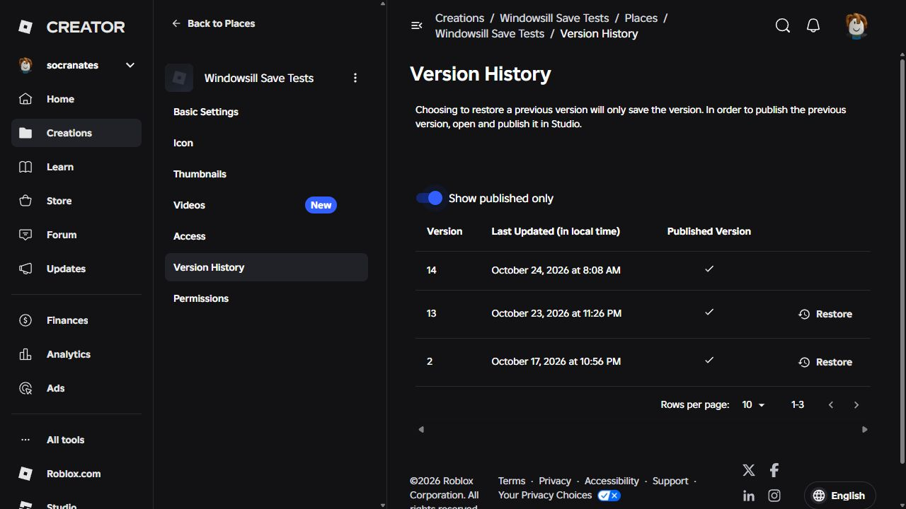
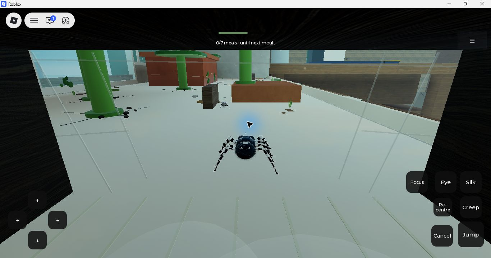

# Private version 14: publication and standalone checks

2026-10-24. The user explicitly approved this exact candidate with “Publish and
test privately.” Evidence **032b5985ac17eeb2** is now published to the existing
private **Windowsill Save Tests**, universe10771634917, place109879630247781.
Creator Dashboard's refreshed published-only history confirms **version14**;
both game access and audience reach remain **Private**. Production was not
published. Game sources remain the CI-qualified273 sources atdd212105.

## Identity and publication

The native saved file is
`C:/Users/natha/claude-xfer/Windowsill-private-current-20261024a1/VerifiedPrivateCurrent.rbxl`,
SHA256 `2dbbb2091c5f1a6a67db3a8188767118d109440f328b3489175ab7c0ab24aca7`.
Its hash still matches after Studio exit. Both native274-source guards pass,
before and after publication, including enabled scripts, exact private target,
normal gameplay, automatic detail and the new test-save namespace
`WindowsillTest_playerRig_20261024a1`. The additional source is the bounded,
read-only arrival observer. No diagnostic fixture, SDK or SelfTest runner was
published. `prepared.json` and `native.json` remain unchanged preparation records.

`publication.json` and `publication-output.txt` retain the approved action and
guard/publication events. Alt+P initiated publication; the File menu's Publish
was clicked before asynchronous completion logs were inspected. Both completion
events report v14, and Dashboard shows one new published version. There were
214 HTTP429 script-history asset-commit failures; they are retained, not erased.
Both actual Player runs subsequently report PlaceVersion14, the intended game
evidence and store. Published asset bytes were not independently downloaded
and rehashed; this is guarded local identity plus Dashboard/runtime evidence.



## Two actual Player arrivals

Studio and heavy test/compiler/Rojo processes were closed before measurement.
The in-app browser did not hand off Play to the already-installed Player; Edge
was unavailable to browser automation. Roblox's documented
[direct app link](https://create.roblox.com/docs/production/promotion/deeplinks)
launched the exact private place, without credentials, auth tickets, downloads
or security-setting changes. The documentation marks public deep links
deprecated; this used the existing installed-app route for the owner's test.

Both ordinary title menus reached New Life and the playable windowsill. These
were normal menu entries, not injected game states or restores. The spider,
nearby living flies, 0/7 meal counter and readable touch labels are visible.
The desktop selected touch controls automatically; that does not qualify a
physical phone or controller. A single W input after the first capture is only
an attempted input, not a traversal or comfort qualification. The Roblox
playtest tip was dismissed in the first run and remained after the attempted
dismissal in the second; it is platform UI, not a game prompt.

| Observation | First run1792847476459 | Fresh run1792847652314 |
|---|---:|---:|
| Runtime PlaceVersion | 14 | 14 |
| Title-ready after probe began | 8.09s | 13.66s |
| Completed15-second windows | 6 | 6 |
| Heartbeat callbacks | 5107 | 4284 |
| First raw Heartbeat dt | 770.41ms | 1320.74ms |
| First interval actually observed since probe began | 67.52ms | 19.77ms |
| Largest observed callback interval across90s | 240.17ms | 638.26ms |
| Final30s callback rate | 57.26/s | 53.14/s |
| Final30s mean / worst callback interval | 17.46 /49.23ms | 18.82 /48.64ms |
| Focus losses, skipped/truncated windows | 0 | 0 |
| CreatorError / recognizable script errors | 0 /0 | 0 /0 |

The first New Life input was13:11:45.616Z; playable capture13:12:04.351Z.
Its final30 seconds are a stationary windowsill sample after the normal intro.
The fresh input was13:15:08.484Z; its final30 seconds mix intro and gameplay.
**These are different workloads, not a matched FPS comparison or speedup.**
No causal improvement is claimed against the older private13 cohort.

The first raw dt includes at least702.89ms before the observer existed; the
fresh run includes at least1300.98ms. It would be wrong to assign those entire
raw values to game code running after probe startup. Actual later callback
pauses still occur, particularly638.26ms in the fresh arrival. The earlier
native stream established Studio/plugin work, but these standalone observations
show that Studio alone cannot explain every arrival hitch. The internal cause
is still unresolved; do not label startup fixed or repeat this same measurement
without a concrete next hypothesis or source change.

Both runs identify the intended evidence/store, report world_failed=false and
no unavailable requested Stat, advance all six observed engine phases, disconnect
seven listeners and remove both render bindings. Each runs90 seconds without
focus loss. Both closed via Roblox's Close Roblox confirmation; owned tray
children were closed only after their game parent exited. Final collectors
bind the complete closed-process log hashes. No game or Studio window remains.



## Warnings and evidence boundaries

Each finalized log retains three CorePackages post-authentication attribution
warnings. Platform warning/error categories, including a ClientMemStatus record
at shutdown, are counted in each `platform-counts.json`; they are not declared
fixed or silently classified as game exceptions. No explicit low-memory warning
line matched in either log. Full account/network logs remain local; the repository
has only probe events, selected warnings, category counts and original hashes.

Final inputs are `player-first-final/player.json` and
`player-warm-closed/player.json`. Earlier `*-live` receipts and
`player-warm-final` were collected before terminal process verification and
remain provisional snapshots. `summarize.py` uses only the closed-process inputs
and rechecks their original hashes, quantile ordering and deployment identity;
`player-summary.json` is its computed summary.

This completes current private publication and bounded Player arrival/ordinary
entry verification. It does not complete the larger audit. Whole-map close
clipping, all-mode natural lives, the current full online rest/save/rejoin loop,
controller/touch comfort, audio balance and physical-phone performance remain
separate coverage. Fresh server prefixes also mean these entries do not prove
cross-server save continuity. Existing save evidence retains its original scope.
Production, main and the OneDrive/Godot/synced reference originals are unchanged.

## Recheck and next work

```text
python docs/private-current/prepare.py --check
python docs/private-current/summarize.py
```

The ordinary game sources already pass full80-suite Linux CI40093189495 plus
the qualified native rig/matrix checks. This publication changes no game code.
Keep the broader optimization goal active. Next prioritize a bounded current
ordinary-life/rest/save exercise and remaining collision/content coverage;
use a new isolated candidate if added instrumentation is necessary. Startup
needs a specific pre-probe/native Player attribution hypothesis, not a claim
that the first raw dt is all game work. Do not publish any new variant or
production build on the strength of this v14-only approval.
